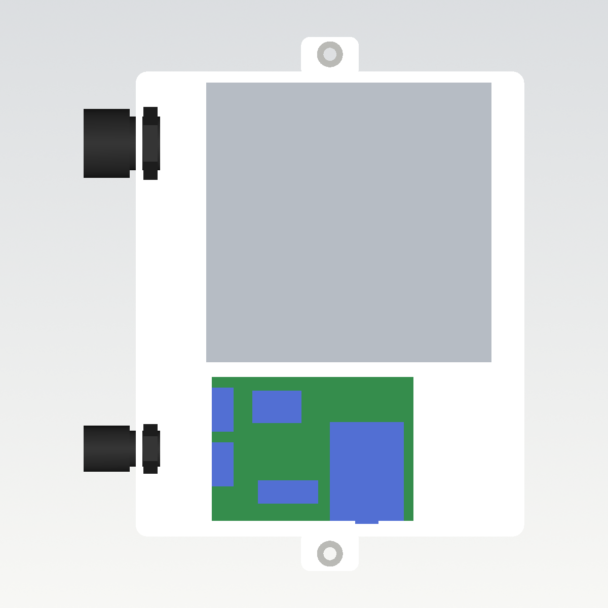
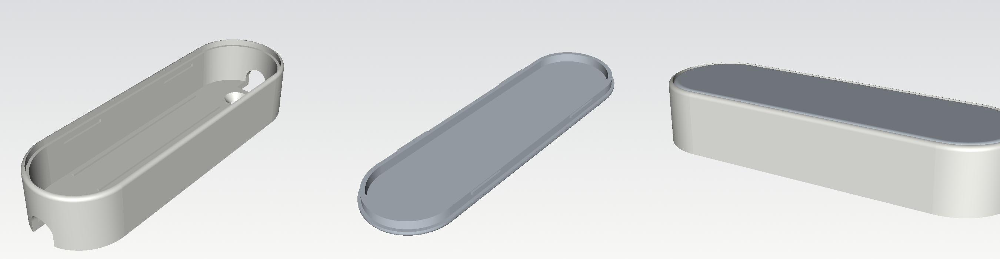
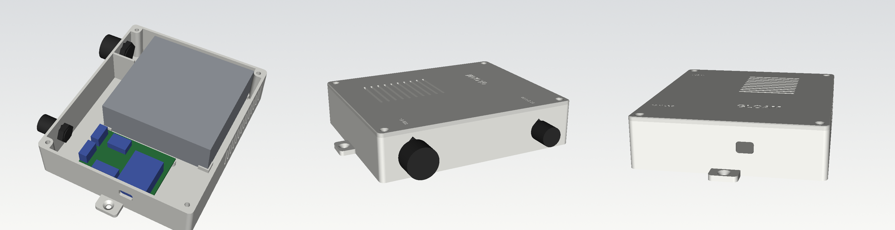
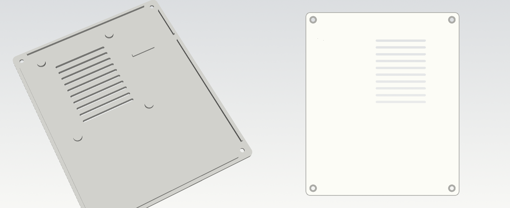

# Gloam CAD sources

Parametric sources for every printed part, written with [CadQuery](https://cadquery.readthedocs.io/). The STEP files in
`../step` open in any CAD program (SolidWorks, Fusion, FreeCAD, Onshape); the STL files in `../stl` are ready to slice.
Change a parameter at the top of a script, run it, and both folders are rewritten.

```sh
python3 -m pip install -r requirements.txt
python3 gloam_fixture.py       # fixture body + diffuser
python3 gloam_controller.py    # controller box + lid + assembly, prints a fit check
```

| Script | Parts | STEP | STL |
|---|---|---|---|
| `gloam_fixture.py` | fixture body, diffuser | `fixture-body.step`, `fixture-diffuser.step` | same names |
| `gloam_controller.py` | controller box, lid | `controller-box.step`, `controller-lid.step`, `controller-assembly.step` | `controller-box.stl`, `controller-lid.stl` |

`controller-assembly.step` places the box, the lid and simple stand-ins for the power supply, the perfboard, the modules
and the cable glands, so you can check the fit before printing. `gloam_controller.py` reports any overlap between them.

### Your own parts

The controller box follows the parts you put in it. Change the power supply, the perfboard or add one extra module that
stands on the floor next to the board, and the walls, gland holes, mains divider, screw columns, lid pads and vents are laid
out again. The same parameters drive the box designer on the [project page](https://open.noq.works/projects/gloam/#kutu-tasarla),
which previews the box in 3D and gives you the STL and STEP files.

```sh
python3 gloam_controller.py --params                                   # names, ranges and defaults (JSON)
python3 gloam_controller.py --set psu_x=129 --out /tmp/box             # a box for an LRS-100-12
python3 gloam_controller.py --set board_x=80 --set board_y=60 \
    --set extra_x=30 --set extra_y=40 --set extra_h=20 --out /tmp/box  # bigger board and a 30 × 40 × 20 mm module
```

| Parameter | Default | Range (mm) | |
|---|---|---|---|
| `psu_x`, `psu_y`, `psu_h` | 99, 97, 30 | 60–200, 50–150, 22–60 | power supply depth (terminal side to back), width (along the terminals), height |
| `psu_divider` | 57.55 | 10–140 | mains divider from the PSU edge nearest the board, between the FG and −V screws |
| `board_x`, `board_y` | 70, 50 | 67–160, 47–120 | perfboard; the Gloam circuit needs at least 67 × 47 mm |
| `extra_x`, `extra_y`, `extra_h` | 0 | 0–120, 0–120, 0–50 | extra module next to the board, held by corner stops (0 = none) |

The defaults give exactly the files in `../stl` and `../step`. The script stops with a message when a choice cannot work
(the divider outside the power supply, a gland that no longer fits on its side of the divider, a box too low for the mains
gland) and warns when the box is larger than a print bed. `gloam-controller.params.json` is the same list as `--params`;
regenerate it when you change `PARAMETRELER`.



## Fixture



A stadium-shaped body (27.4 × 89.9 × 15.8 mm) with two 8 mm COB strips between low ribs, two countersunk screws through
the floor (3 mm countersunk wood screws, 12–16 mm long) and a cable arch (7.5 mm wide, 7 mm high) at both ends for round ~6 mm cable. The diffuser drops onto the
ledge at the top and is held by four small bumps that click into grooves in the long walls.

Main parameters: `BODY_R`, `END_CENTRE`, `BODY_H`, `WALL`, `FLOOR`, `RIB_X`, `SCREW_Y`, `CABLE_W`, `CABLE_SPRING`,
`DIFF_R`, `LIP_OUT`, `NUB_*`, `GROOVE_*`.

## Controller



Inside 130 × 156.5 × 32 mm; outside 134.8 × 161.3 × 37.4 mm with the lid, 185.3 mm long across the mounting ears.

- **Power supply:** Mean Well LRS-75-12 (99 × 97 × 30 mm, 12 V 6 A). It sits in four corner stops on the floor and four
  pads under the lid hold it down. For the smaller LRS-50-12 (99 × 82 × 30 mm) set `PSU_Y = 82`.
- **Mains side:** the PSU terminals face the cable wall. A divider between terminal 3 (FG) and terminal 4 (−V) keeps
  the mains wiring and the PG11 mains gland apart from the 12 V side; a rib under the lid continues it over the
  terminal block.
- **12 V side:** a 50 × 70 mm perfboard on four standoffs (M2 × 6 self-tapping screws), with the D1 mini, the
  step-down, the ULN2003A and two 3-way terminal blocks facing the wiring channel. The LED line leaves through a PG7
  gland. A 13 × 8 mm slot in the front wall reaches the D1 mini's USB port and takes micro-USB and USB-C plug bodies.


- **Lid:** four M3 × 8 countersunk screws (DIN 7991) into M3 heat-set inserts in the corner columns; a lip locates it.
- **Air:** vertical slots behind the PSU and slots in the lid above it, 2 mm wide.
- **Mounting:** two ears with countersunk holes for 4 mm screws.

Main parameters: `PSU_X`, `PSU_Y`, `PSU_H`, `PSU_TERMINALS`, `WIRING`, `BOARD_*`, `PARTS`, `GLANDS`, `INSERT_D`,
`INSERT_DEPTH`, `EAR_*`, `VENT_*`, `FIT`.

### Hardware

| Part | Qty |
|---|---|
| Mean Well LRS-75-12 | 1 |
| PG11 polyamide cable gland, Ø5–10 mm (mains) | 1 |
| PG7 polyamide cable gland, Ø3–7 mm (LED line) | 1 |
| M3 brass heat-set insert, Ø4.0 mm hole, up to 6 mm long | 4 |
| M3 × 8 countersunk socket screw, DIN 7991 | 4 |
| M2 × 6 self-tapping screw (for plastic) | 4 |
| 4 mm countersunk screw for the wall or beam | 2 |

`INSERT_D` is set for the common M3 × 5.7 inserts (outer Ø4.6 mm). Check your inserts and change it if needed.

## Printing

PETG, 0.4 mm nozzle, 0.2 mm layers, no supports.

| Part | Orientation | Notes |
|---|---|---|
| Fixture body | upright | white |
| Diffuser | visible face down (as exported) | clear |
| Controller box | floor down | 6 walls (2.4 mm), 30 % infill |
| Controller lid | top face down (as exported) | |

A ready-made Bambu Studio project with these settings is `../3mf/gloam-a1.3mf`: the whole set (16 bodies, 16 diffusers, the
controller box and its lid) on six plates, sliced for the Bambu Lab A1 (0.4 mm nozzle, textured PEI plate, Bambu PETG HF and
PETG Translucent), one filament per plate. About 15 minutes per body, 13 per diffuser, 2 h 40 min for the box and 1 h 15 min
for the lid on the A1; Bambu Studio converts the project for other printers.

The holes in the walls have a 45° roof so they print without support. Press the inserts in with a soldering iron at
about 230 °C.

## Safety

The controller is connected to mains voltage. Use a fully enclosed power supply, connect the earth wire to the FG
terminal, tighten both glands, and close the lid before switching on. If you are not sure, have the mains side wired
by a qualified electrician.
